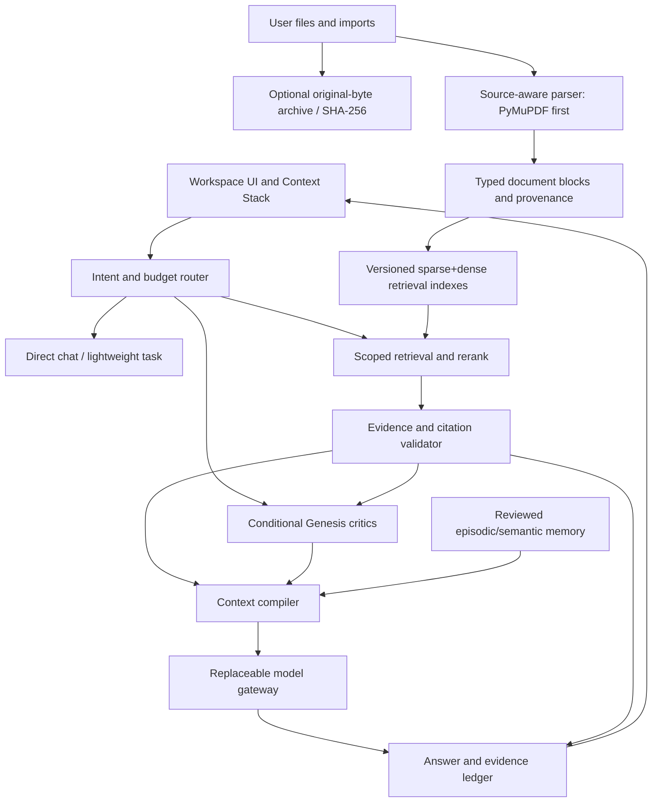

# Parexa 2.0: Evidence-first Intelligence Workspace

**Status:** architecture proposal and staged engineering plan, October 2026. This document distinguishes shipped v1 behavior from proposed capabilities. No benchmark results are implied.

## 1. Product thesis

Parexa is not meant to become another unbounded chatbot with more agents. Its job is to let a person understand, compare, discuss, and build on their own material using **traceable evidence**, explicit context scope, and compute-efficient reasoning.

Priorities, in order: **data safety -> evaluation -> structured ingestion -> retrieval fidelity -> contextual memory -> agent routing -> distinctive interface**. Keep a usable single-repository application until an independently tested component is mature enough to extract.

## 2. Lessons to borrow from other projects

| Origin | Transferable engineering principle | Parexa implementation boundary |
| --- | --- | --- |
| **Corpus Indomicus / Regas** | Source-byte integrity, provenance, content hashes, measured storage tradeoffs | Optional content-addressed original document store, never silently destroy imported objects; compression only after byte-exact validation |
| **Ortheon** | Parse first, reason second; typed geometry/relations with source references | Document block tree for text/table/figure/formula; visual region analyzers are optional backends, not mandatory dependencies |
| **Arline Studio** | Navigation is not the same as context; reviewed facts and versions | Explicit Context Stack with document scope, permissions, and user-reviewed semantic memory |
| **Asterion** | Academic evidence graph and learner state should not be conflated | Source -> section -> claim -> concept links with separate optional personal study model |
| **Laya/Jev retrieval research** | Investigate compact representations and conditional computation through benchmarks | Lightweight local retrieval/embedding adapters evaluated against robust baselines before replacement |
| **Harpha / Orbis** | Deterministic evaluation, local-first assets, portable workspaces | Inspectable execution traces, exportable workspaces, predictable offline UI; no direct engine integration |

**Explicitly excluded for now:** merging other repositories, introducing an unverified custom embedding architecture, or shipping a generative visual parser as a fact source before grounded evaluation.

## 3. Proposed architecture

**Data lifecycle:** store source references separately from derived text and vectors. Document lookup, conversation history, user-approved memory, and model context are distinct data domains. Avoid silently treating a viewed item as a selected source.

## 4. Core data contracts (proposal)

1. `SourceObject { sha256, media_type, byte_length, origin, stored_path?, retention_policy }`: canonical source identity; immutable when retained.
2. `DocumentBlock { block_id, source_sha256, page, bbox?, modality, text?, parser_version, confidence?, parent_id? }`: typed extract with page or spatial source anchors.
3. `IndexVersion { model_id, dimension, normalization, algorithm, parser_version, created_at }`: vectors are versioned; embedding model changes never delete old collections implicitly.
4. `RetrievalHit { block_id, rank, lexical_score?, vector_score?, rerank_score?, retrieval_version }`: inspected hits, not a narrative generated by an LLM.
5. `AnswerEvidence { block_id, source_sha256, page?, span_start?, span_end?, claim_id? }`: machine-verifiable links from answers back to sources.
6. `ContextScope { workspace_id, selected_sources, selected_memories, tool_permissions, max_budget }`: explicit permission boundary for each request.

Source objects must be opt-in or governed by clear retention settings: retaining raw documents can be useful for citations and expensive in storage. Indexed text is a derivative, not a reversible replacement for a PDF.

## 5. Retrieval: existing versus proposed

Current v1 creates LlamaIndex nodes with a 1024-token-ish sentence splitter, stores embeddings in Qdrant, attempts BM25 fusion when a docstore is populated, and applies an optional cross-encoder reranker. Loading an index from a vector store may leave the docstore empty, so the advertised hybrid path needs a controlled test.

Proposed retrieval stages:

1. Identify selected workspace/files and allowed source types before touching the index.
2. Retrieve lexical candidates and semantic candidates through independent, observable branches.
3. Fuse by reciprocal-rank fusion (RRF), then rerank only when justified by query complexity and latency budget.
4. Resolve every returned chunk to a source block and source page; reject unknown or stale references.
5. Form the generation context with explicit citations. If retrieval is unavailable, return a typed failure rather than unconstrained chat.

Evaluate Qdrant-native dense + sparse retrieval against an independently indexed BM25 baseline. Do not introduce a new sparse model, Matryoshka truncation, or vector quantization without index-quality measurements and index versioning. Backfill/reindex must use staging collections with validation before a cutover.

## 6. Document parsing

- **Fast lane:** native PDF text via PyMuPDF, record page and coordinates; text/Markdown parse without OCR.
- **Hard lane:** detect low-quality pages/tables/forms; run OCR or layout-aware structure parsing selectively, with page-level warnings and costs.
- **Optional research lane:** compare Docling for structured tables/reading order and Ortheon-derived specialized diagram perception. Neither is a universal default.
- **Evidence:** original page image or PDF span, bounding box, table row/cell associations, parser identity, and confidence should survive indexing.

Current code uses EasyOCR as a sparse-text fallback; adding a new parser is not automatically an improvement. Compare document types and measurable accuracy before choosing a default.

## 7. Memory and context

Keep four things separate: (a) conversational transcript, (b) rolling conversation summaries, (c) retrieved document evidence, and (d) user-reviewed long-term facts. Proposed episodic memory includes time and source; proposed semantic memory includes identity, relation, confidence, and revision provenance. A deleted or edited fact must not remain silently active in generated context.

The **Context Compiler** accepts explicit scopes and budgets, deduplicates overlap, resolves contradictions conservatively, and produces an inspectable bundle passed to the model. A user may browse an item without granting it influence over the answer.

## 8. Agents and model runtime

Use conditional orchestration rather than invoking Genesis on every request. Simple chat should take the short path; ambiguous or high-stakes document tasks may require an independent verification pass. A critic should see the underlying evidence snippets, not only a draft and a list of file names.

Expose adapters for chat, embedding, reranking, OCR, and optional vision independently. Full local-first inference requires a local **chat** adapter; the existing LM Studio integration currently covers only embedding. Prefer explicit compatibility tests and bounded concurrency to a wholesale framework rewrite.

## 9. Interface direction: Parexa Observatory

Move beyond a generic gradient bubble chat. Proposed information architecture:

- **Left:** Workspaces, conversation threads, source collections, saved views.
- **Center:** Reading/reasoning canvas with chat, compare documents, and structured answers.
- **Right:** Evidence Ledger with clickable source passages, citation validity, parser provenance, and confidence/unknown markers.
- **Bottom:** Command Dock with model route, budget, source scope, and execution state.
- **Modes:** Ask, Explore, Verify, Synthesize. Mode selection should change the execution plan, not just the label.

Visual direction: restrained editorial typography, soft scientific instrument lines, physical-paper reading surfaces, careful contrast, minimal gradients, keyboard-driven shortcuts, and progressive detail. Make trust visible before adding decorative effects.

## 10. Phases and acceptance criteria

| Phase | Deliverable | Acceptance gate |
| --- | --- | --- |
| P0: Safety foundation | Fail-closed RAG, preserve vector collections, localhost default, upload cap, regression tests | Existing collection never auto-deleted; RAG outage produces explicit non-answer; tests pass |
| P1: Evidence contract | Source IDs, raw-byte retention policy, structured parser metadata | Source/page round trips; canonical hash validation; mixed-PDF test set |
| P2: Retrieval evaluation | Baseline dense, lexical, hybrid, reranking pipeline with index versions | Recall@5, nDCG@10, citation precision, p50/p95 latency and RAM measured |
| P3: Context and memory | Context Stack + approved facts + reversible edits | Scope isolation, revocation test, contradiction handling, reproducible context snapshots |
| P4: Model and agent router | Provider plugins and conditional Genesis | Provider fallback explicitly labeled; evidence unchanged across critique; bounded calls/cost |
| P5: UX and distribution | Observatory UI, source inspector, data export/backup | End-to-end upload -> retrieve -> inspect -> export; keyboard and mobile accessibility |

Current branch implements **part of P0**. Its test suite has not been run in an installed application environment as part of the initial code change. All other phases remain proposals.

## 11. Benchmark protocol

Create a small, permission-safe, frozen set of native-text, scanned, table-heavy, diagram-heavy, and multilingual PDFs with known page/region answers. Record document checksums; separate collection/storage fidelity from semantic answer quality.

Record at minimum: ingestion seconds per page, OCR accuracy on annotated lines, parser block recall, Recall@5, MRR/nDCG@10, source-attribution precision, answer abstention accuracy, p50/p95 total latency, peak RAM/VRAM, token/API cost, and negative cases (no file, deleted file, dim mismatch, index outage, prompt-injected document). Use the same source corpus and queries for A/B comparisons, and declare which metrics require annotation.

## 12. Reference technology (research, not installed by this plan)

- [Qdrant: hybrid and multi-stage queries](https://qdrant.tech/documentation/search/hybrid-queries/)
- [Qdrant: dense + sparse lexical search](https://qdrant.tech/documentation/search/text-search/hybrid-search/)
- [Docling: structured document processing](https://github.com/docling-project/docling)
- [Flask: async and await behavior](https://flask.palletsprojects.com/en/stable/async-await/)

Flask's async views do not themselves increase concurrent request capacity in a WSGI deployment; use measurements before considering an ASGI backend and an actual task queue. A new web framework will not magically make OCR faster.
