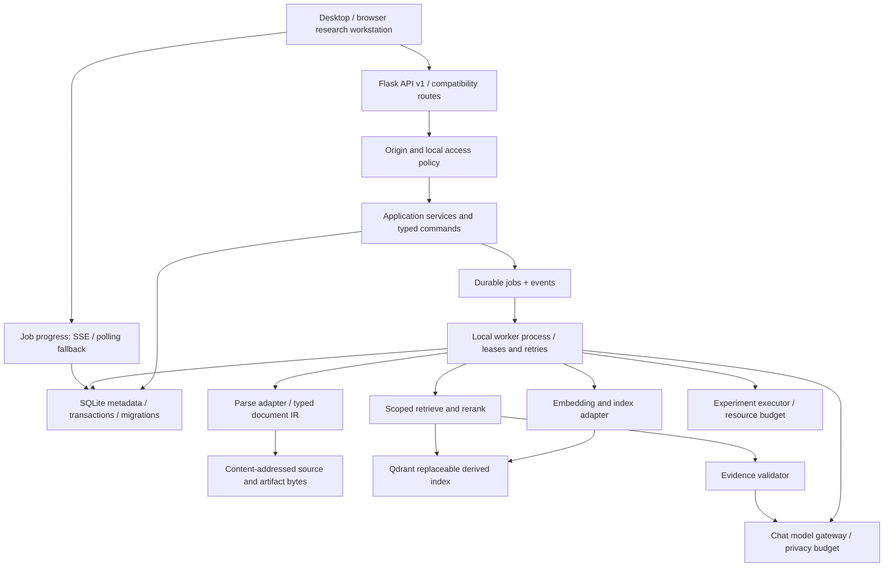

# Parexa 3.1 — Research Intelligence Backend Architecture

**Status:** proposed implementation blueprint. **Baseline:** Parexa 3.0 main after Research OS v1 merge. No unimplemented feature in this document is claimed to exist.

## 1. Product invariants

1. Preserve original document bytes before parsing, embeddings, or model inference; SHA-256 records must remain verifiable.
2. Treat SQLite as the **transactional source of truth**, Qdrant as a derived, replaceable retrieval index, and object files as immutable source/artifact bytes.
3. Every AI answer involving source documents must preserve the retrieval scope and evidence IDs or explicitly report that evidence retrieval failed. Do not silently revert to ungrounded answers.
4. Separate archival, ingestion, indexing, retrieval, synthesis, evidence review, and experimental execution. Their failures and retries must not corrupt one another.
5. Do not send private content to an external model/search service unless the relevant workspace action and provider configuration expressly permit it.
6. Make runs observable and reproducible: version of parser, chunker, embedding model, retrieval policy, prompt, selected model, settings, inputs, and artifacts.
7. Local-first does not imply authentication. Stay on loopback until a secure authentication/authorization and CSRF architecture is implemented and tested.

## 2. Observed state and gaps (verified by source inspection)

| Area | Existing implementation | Missing boundary |
|---|---|---|
| HTTP | Flask routes in `parexa_interface/app.py`, Research blueprint in `research_api.py` | App factory, typed contracts, unified error taxonomy, API versioning, controlled background jobs |
| Research metadata | `storage/research_store.py` uses SQLite WAL, project/source/experiment/evidence/note/task tables | explicit migrations, versioned artifacts, run/job/event tables, transactional outbox |
| Original files | SHA-256 content-addressed files, archived before chat parse; vault-only files are `stored` | robust ingestion queue, archive/index lifecycle, workspace backups, GC policy |
| Retrieval | LlamaIndex + Qdrant, optional sparse/dense and rerank; fail-closed selected-file behavior | index/version catalog, evidence span locator, evaluation corpus, repair/reindex |
| Models | model gateway supports LM Studio/Ollama/Cerebras; local model discovery | scheduling/resource policy, measured inference runs, context compiler, output validation |
| Research logic | Genesis multi-agent draft/critics/synthesis, manual evidence ledger | explicit researcher workflows, verification pipeline, experiment execution |
| UI | `/research` and `/` coexist | real job stream, source/page viewer, run inspectors and policy controls |

**Important baseline caveat:** chat upload archival and indexing are not currently atomic across SQLite + filesystem + Qdrant. A crash or failure can leave a preserved file with status `stored`. That is safer than dropping bytes but requires reconciliation/repair tooling.

## 3. Architectural decision record

**Decision:** modular monolith + local worker process + durable SQLite job queue (first milestone). Keep Flask as transport, existing AI adapters as replaceable drivers, Qdrant as derived storage, and filesystem objects as durable archives. Avoid Kafka, Celery/Redis, distributed Kubernetes, or a new vector database without measured necessity.



**Why a worker:** OCR, parsing, large indexing runs and model calls can exceed HTTP timeouts and must survive browser reloads. A worker may initially be launched as `python -m parexa_interface.worker`, with its own process and bounded concurrency. SQLite remains appropriate for one-machine moderate concurrency; reconsider only after profiling.

## 4. Backend package layout

```text
src/code/parexa_interface/
  app.py                         # compatibility entrypoint; delegate to app factory
  web/
    factory.py                   # create_app(), blueprint registration, limits, lifecycle
    research_v1.py              # typed research HTTP endpoints
    jobs_v1.py                  # job status/events/cancel/retry
    dependencies.py             # service and repository wiring
  domain/
    documents.py                # document + version transitions
    evidence.py                 # immutable source spans, claims and judgments
    experiments.py              # experiment run specification
    jobs.py                     # job states and transition invariants
    models.py                   # provider capabilities, locality, resource cost
  application/
    archive.py                  # import source, dedup, metadata
    ingestion.py                # parse/chunk/embed/index workflow
    retrieve.py                 # scope-aware hybrid retrieval
    research.py                 # research sessions and synthesis
    experiments.py              # recorded experiment execution
  infrastructure/
    metadata/sqlite.py          # WAL sessions, migrations and transactions
    metadata/migrations/        # numbered forward migrations
    objects/files.py            # atomic SHA-256 file writes and integrity
    vectors/qdrant.py           # adapter, versioned collections
    models/gateway.py           # wrappers around existing LM Studio/Ollama/Cerebras
    queue/sqlite.py             # job claiming, lease, retry and heartbeat
    telemetry/metrics.py        # observable, measured counters
  workers/
    main.py                     # bounded local worker loop
    handlers.py                 # ingest, reindex, verify, embed, retrieve, evaluate
  services/                     # existing adapters progressively moved; no big-bang rewrite
  storage/                      # existing stores retained and wrapped during migrations
```

Do not move existing code in one patch; create adapters and route operations incrementally. Continue importing old modules until integration tests cover the new seams.

## 5. Database schema extensions

Migration policy: never delete or rebuild the original `research.sqlite3`; introduce schema versioning via `PRAGMA user_version` (or a migrations table), run preflight backups before structural migration, and make migration scripts idempotent where feasible.

| Entity | Core fields | Responsibility |
|---|---|---|
| `document_versions` | `id, document_id, blob_sha256, revision, imported_at, parser_revision, state` | source/version lineage; original byte hash is immutable |
| `document_blocks` | `id, version_id, type, page, bbox_json, text, ordinal, checksum` | typed paragraph/table/figure/equation blocks and locators |
| `index_generations` | `id, workspace_id, embed_provider, model, dimension, chunker_version, collection, state, created_at` | allow upgrades/reindex without destructive vector resets |
| `index_memberships` | `generation_id, block_id, vector_point_id` | map source chunks to derived index points |
| `research_runs` | `id, project_id, workflow, status, spec_json, started_at, completed_at` | tracked research executions and configurations |
| `run_inputs` | `run_id, source_version_id, scope_json` | immutable manifest of source inputs |
| `run_outputs` | `run_id, artifact_id, role` | durable outputs/metrics/logs |
| `artifacts` | `id, sha256, mime, size, creator_run_id, created_at` | immutable datasets, reports, logs, plots |
| `evidence_spans` | `id, version_id, block_id, char_start, char_end, quoted_text_hash` | traceable source locations for citations |
| `claim_evidence` | `claim_id, span_id, relation, review_state, reviewer_note` | support/refute/unclear links with review provenance |
| `jobs` | `id, type, state, payload_json, idempotency_key, attempts, max_attempts, lease_until, heartbeat_at, error_code, created_at, updated_at` | durable execution/repair |
| `job_events` | `job_id, seq, timestamp, phase, progress, details_json` | progress and inspection timeline |
| `model_runs` | `id, parent_run_id, route, model, prompt_hash, context_hash, input_tokens, output_tokens, elapsed_ms, status` | measured model use, not guessed telemetry |

SQLite FKs and uniqueness constraints should enforce lifecycle references. Index `jobs(state, lease_until)`, `job_events(job_id,seq)`, `document_blocks(version_id,page,ordinal)`, and `claim_evidence(span_id)`. Never duplicate entire original files inside the metadata database.

## 6. Source preservation -> research evidence pipeline


### State machines

- **Source:** `stored -> parsing -> parsed -> indexing -> indexed`; alternative terminal/repair states `parse_failed`, `index_failed`, `quarantined`. Source can remain archived even if downstream processing fails.
- **Job:** `queued -> running -> succeeded`; alternatives `retry_wait -> queued`, `failed`, `cancelled`. Reclaim expired lease only when retry policy allows. Successful jobs must be idempotent on reprocessing.
- **Index generation:** `building -> validating -> active`; old active generation remains available until the new generation passes compatibility and benchmark checks. Do not replace/delete a working collection on dimensionality mismatch.
- **Claim:** `draft -> source_linked -> reviewed`; `verified` must mean checked against source bytes, not merely generated by an LLM. Source quotation match and truth of scientific interpretation are distinct validation dimensions.

### Structured document IR

```json
{
  "block_id": "uuid",
  "document_version_id": "uuid",
  "page_number": 4,
  "kind": "paragraph",
  "bbox": [32.5, 81.2, 514.3, 173.8],
  "text": "Extracted content...",
  "method": "pymupdf",
  "confidence": null,
  "text_sha256": "hex-sha256"
}
```

Coordinates are optional and tied to a known page coordinate frame; OCR-derived confidence is not directly interchangeable with model confidence. Preserve method, parser version, warnings, and checksums. Scanned PDFs may require OCR; do not treat failed extraction as an empty scientific source.

## 7. Research orchestration

Define explicit workflow recipes rather than free-running agents:

| Workflow | Deterministic stages | Output |
|---|---|---|
| `literature_review` | select scope -> retrieve -> cluster/compare -> source-link -> critique -> export | cited outline + source ledger |
| `hypothesis_assessment` | declare claim -> find support/counterevidence -> flag gaps -> review | evidence matrix, unresolved questions |
| `reindex_source` | verify bytes -> parse -> chunk -> embed -> validate -> activate index version | new safe generation |
| `compare_models` | fix dataset/prompt -> execute models -> compute metrics -> persist manifest | reproducible comparison |
| `experiment_report` | load experiment + artifacts -> compute metrics -> evidence audit -> write | report with measured values |

Use an orchestrator only for **bounded, explicit workflows**. The Genesis draft/critic/synthesis path becomes an optional stage in selected workflows, not a universal default; simple questions should not trigger extra agents. Each stage emits events and artifacts.

## 8. Retrieval policy

1. Resolve project/workspace, document versions, selected sources and privacy policy **before** querying.
2. Dense/sparse candidates are version-scoped and project-scoped, with explicit filters. Use BM25 + dense retrieval and optional rerank only when configured.
3. Require provenance for each candidate: exact `document_version_id`, block/page offsets, method and score. A missing source mapping invalidates that candidate.
4. Fusion policy (e.g. RRF), candidate sizes and rerank thresholds are versioned in the run specification. Do not assert empirical superiority without a benchmark.
5. Treat source snippets as untrusted text: never let document text override system instructions, tool permissions, or workspace boundaries.
6. Compile context using an explicit token budget with reserved answer/system overhead, dedup sources and cite block IDs.
7. If a source-required query has no usable evidence, return `insufficient_evidence`; never silently hallucinate a source-grounded answer.

Example normalized retrieval result:

```json
{
  "source_version_id": "version-uuid",
  "block_id": "block-uuid",
  "page": 3,
  "span": [102, 240],
  "score": 0.71,
  "retriever": "dense+bm25",
  "index_generation_id": "index-uuid",
  "text": "Actual passage..."
}
```

Scores above are schematic example values, not measured Parexa model results.

## 9. Experiment runner

Do not execute untrusted model-written Python in Flask. v1 experiment records remain **metadata-only**. A future executor must use opt-in, explicitly defined job types and arguments; constrained subprocesses or containers; allowlisted paths; CPU/RAM/time limits; no default network access; and abort/cancellation controls. A container is not a complete security boundary by itself.

**Manifest:** immutable input hashes, environment lock/version, Git revision, seed(s), model/provider versions, hardware information *when measured*, code revision, command, budget, logs and output hashes. A claim of reproducibility requires replaying the manifest or a documented environment exception.

## 10. Job transport and observability

**Submission:** `POST /api/v1/jobs` with a validated job type and idempotency key returns HTTP 202, `job_id` and `status_url`. Use whitelist dispatch, not arbitrary function names supplied by clients.

**Progress:** `GET /api/v1/jobs/{id}` and `GET /api/v1/jobs/{id}/events?after=<seq>` first; add SSE when cursor/resume and resource limits are tested. Every event has monotonically increasing sequence per job.

**Retry:** exponential capped backoff + bounded attempts; on crash recover only expired-lease jobs. Persist a durable outbox record in the same transaction as a state change when external indexing needs coordination.

**Cancellation:** stop queued jobs immediately; running jobs check a cancellation flag between safe phases and clean up temporary artifacts. Never claim that cancellation can interrupt arbitrary opaque GPU calls.

**Metrics:** measured ingest duration, extracted pages, OCR rate, chunks, index errors, retrieval recall, source verification coverage, GPU memory only if a real telemetry adapter exists, and SQLite/object/disk usage.

## 11. API v1 boundary

| Endpoint | Meaning |
|---|---|
| `POST /api/v1/research/runs` | launch an explicit research workflow; returns durable run/job IDs |
| `GET /api/v1/research/runs/{id}` | state, manifest, inputs and outputs |
| `POST /api/v1/documents/{id}/index` | queue non-destructive parse/reindex from preserved original |
| `GET /api/v1/documents/{id}/blocks?page=N` | structured page block data and provenance |
| `POST /api/v1/retrieval/query` | scoped retrieval with source spans and retrieval trace |
| `POST /api/v1/evidence/validate` | quote/span integrity checking; does not certify scientific truth |
| `POST /api/v1/experiments/{id}/runs` | bounded, reviewed experiment spec execution |
| `GET /api/v1/jobs/{id}` | status and retry/cancel eligibility |
| `GET /api/v1/jobs/{id}/events` | ordered progress events |
| `GET /api/v1/system/diagnostics` | actual adapter health, storage quotas, measured counters |

Retain current `/api/research/*`, `/api/chat` and `/api/upload` routes for compatibility during migration. New contracts should include structured error codes, stable pagination, maximum page sizes, and schema validation. Do not expose model endpoints, filesystem paths, credentials or arbitrary command execution through user JSON.

## 12. Efficiency and memory

- Avoid loading entire PDFs into RAM: parse sequentially page-by-page; persist checkpoints and process in bounded batches.
- Do not store copies of large original bytes in SQLite or Qdrant payloads; use source references and compact snippets.
- Source-object deduplication operates by SHA-256. Additional compression is optional and must pass exact byte-roundtrip tests; do not promise unrealistic ratios.
- Use SQLite WAL and brief transactions. Never hold database write transactions open while calling OCR or LLM providers.
- Limit concurrent embedding and generation calls according to real model resource measurements rather than CPU thread counts alone.
- Cache parse results by `(source_sha256, parser_version, options_hash)` and embeddings by `(chunk_hash, embedding_model_id, dimension, normalization_version)`; invalidate with version changes.
- Index updates are incremental, non-destructive and reversible via generation pointer switches.

## 13. Threat model and privacy

- Never expose the current unauthenticated Flask instance to LAN/WAN. A cross-origin check alone does not constitute full CSRF protection or authentication.
- Validate source magic signatures and size ceilings; PDF parsing and OCR are treated as untrusted-input processing with worker isolation and deadlines.
- Treat retrieval content as untrusted instructions. No tool invocation may be justified solely by text inside uploaded sources.
- Require explicit provider locality labels and cloud consent at run level; fail closed on missing consent.
- Prevent IDOR when future multi-user workspaces are introduced; bind every document, evidence span and run to an authorized scope.
- Protect local data backups and migration rollback; use directory permissions and optional OS encryption where appropriate.

## 14. Evaluation gates

| Gate | Required signal |
|---|---|
| Data safety | byte-for-byte SHA-256 integrity and crash-recovery test across archive/index boundaries |
| Index safety | dimension migration never deletes an active generation; rollback test passes |
| Retrieval quality | Recall@k, MRR/nDCG where labeled, quote attribution precision, project-leakage = 0 |
| Groundedness | evidence-support annotation by human reviewers; unsupported citation rate reported |
| Latency | P50/P95 per stage and full workflow under representative PDF sizes |
| Memory | peak RAM/VRAM measured, bounded concurrency at real source volumes |
| Workflow reliability | recoverable jobs, successful idempotency, explicit cancellation and error events |
| UI/API compatibility | `/` chat + `/research` contracts and existing browser smoke remain green |

Do not invent performance targets without representative dataset baselines. Benchmark on real scanned, mixed, and text-layer PDFs, including documents with tables and formulas.

## 15. Practical implementation sequence

### P0 — Backend reliability and migrations

Add app factory behind current entrypoint, versioned SQLite migrations, typed errors, document lifecycle reconciliation, durable jobs and idempotency. Write crash/failure tests **before** enabling automatic ingestion.

### P1 — Source pipeline and provenance

Store typed page blocks, source spans, parser versions and indexing generations. Implement vault `index` endpoint, rerunnable parse/index worker and page/block retrieval. Deliver a minimal source viewer based on those blocks.

### P2 — Evidence-driven research workflows

Implement scoped retrieval and evidence verification, explicit context compiler and bounded workflow recipes, then wire current Genesis as an optional synthesis/critique step.

### P3 — Experiment reproducibility

Introduce sandboxed runners, immutable manifests, metrics/artifact files, evaluation datasets and reproducibility reports. Implement real telemetry only when adapters are actually available.

### P4 — Portable workspaces and optional deployment

Transactional export/import, backup verification, quotas, remote-model policies and authentication only if network deployment becomes a deliberate goal.

## 16. Non-goals

No fresh language-model training in this architecture release, no invented in-house embedding algorithm, no premature Rust rewrite, no unbounded autonomous agent, no replacement of Qdrant without benchmark justification, and no distributed deployment solely for aesthetic sophistication.

## 17. Definition of done for the next coding PR

1. Existing chats, saved research records and source bytes remain accessible without migration loss.
2. At least one vault-only PDF can be queued, parsed, indexed and used for a source-scoped query after a browser reload.
3. Intentional OCR/index/provider failures result in inspectable job events and safe source preservation.
4. Duplicate job submission with the same idempotency key produces one logical execution.
5. Index-model dimension mismatch preserves the active generation, with an explicit non-destructive rebuild path.
6. Every citation resolves to an original document version, page and block/offset or is labeled unverified.
7. New and existing backend, API and browser test suites all pass with a reproducible configuration.
